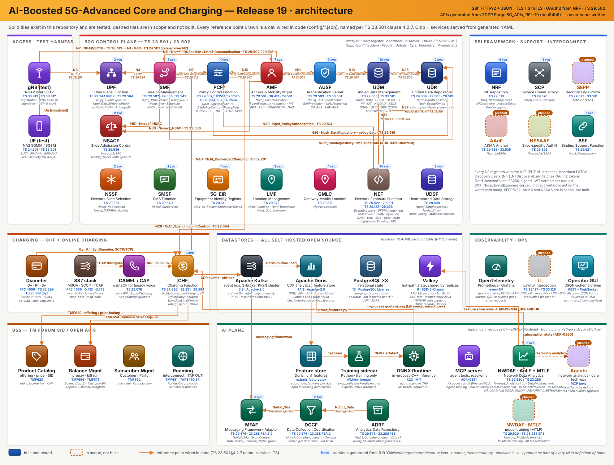

<p align="center">
  <a href="https://github.com/core5gaBssOss/core5gaBssOss/actions/workflows/ci.yml"></a>
  <a href="https://scorecard.dev/viewer/?uri=github.com/core5gaBssOss/core5gaBssOss"></a>
  <a href="LICENSE"></a>
  
  
  
</p>

<h1 align="center">
  <picture>
    <source media="(prefers-color-scheme: dark)" srcset="docs/assets/title-dark.svg">
    
  </picture>
</h1>

<p align="center">
  <picture>
    <source media="(prefers-color-scheme: dark)" srcset="docs/assets/motto-dark.svg">
    
  </picture>
</p>

A modular 5G Core, charging and BSS implementation in modern C++, targeting 3GPP **Release 19
(5G-Advanced)**. Every Network Function's API is generated from the official 3GPP OpenAPI YAML,
never hand-written, and implemented procedures are traced to their TS clauses in
[`docs/TRACEABILITY.md`](docs/TRACEABILITY.md).

- **5G Core:** NRF, AMF, SMF, UPF, PCF, UDM, UDR, AUSF, NSSF, NEF, SCP, BSF and Release 19 NFs
  including NWDAF, 5G-EIR, SMSF, NSACF and Lawful Interception. HTTP/2 SBI with mTLS and OAuth2.
- **Charging:** the CHF of TS 32.290/32.291, with Diameter Gy/Rf, Sy and CAMEL/CAP for legacy
  networks.
- **BSS:** TM Forum SID-aligned services (TMF620, TMF632, TMF651, TMF654); products and tariffs are
  catalog data, not code.
- **OSS:** an operator console (React + JSON Forms) for NF configuration and approvals, TS 28.552
  performance counters and Prometheus business alarms.
- **AI:** NWDAF analytics, and AI-assisted quota sizing in the CHF (off by default), run in-process
  with ONNX Runtime. The model advises; a deterministic engine decides.

This is an open, Apache-2.0 reference implementation that aims at production grade. It is **not
deployable in production yet**: [`docs/COMPLIANCE_P1_P15.md`](docs/COMPLIANCE_P1_P15.md) lists what
still blocks it, including Lawful Interception gaps.

<p align="center">
  <a href="docs/diagrams/architecture.svg">
    <picture>
      <source media="(prefers-color-scheme: dark)" srcset="docs/diagrams/architecture-dark.svg">
      
    </picture>
  </a>
</p>

## Status

| Area | Status |
|---|---|
| SBI framework and code generation from the R19 YAML | Done |
| Control plane: UE registration and PDU session establishment, end to end over real NGAP/NAS | Done |
| User plane: PFCP and an eBPF/XDP uplink GTP-U path (lab fixture, not a gNB-facing N3) | Done for what is stated |
| Charging and TM Forum BSS | Verified end to end in the lab |
| NWDAF and AI/ML pipelines | In progress |
| Release 19 NFs (Tier 2/3) | In progress: 10 of 16 Tier 2 NFs built; Tier 3 not started |
| Operator console | Started |
| Lab packaging (Compose, Helm) | Partial |

Details for every row: [`docs/OVERVIEW.md`](docs/OVERVIEW.md).

## Getting started

Requires CMake 3.28+, Ninja, a C++20/23 compiler (CI uses GCC 15.2) and
[vcpkg](https://github.com/microsoft/vcpkg) in manifest mode.

```sh
git clone https://github.com/microsoft/vcpkg.git ~/vcpkg
~/vcpkg/bootstrap-vcpkg.sh -disableMetrics
scripts/setup-asn1c.sh   # patched asn1c for the NGAP/LI ASN.1 targets; idempotent

cmake -S . -B build -G Ninja \
  -DCMAKE_TOOLCHAIN_FILE=$HOME/vcpkg/scripts/buildsystems/vcpkg.cmake \
  -DCMAKE_BUILD_TYPE=Debug
cmake --build build
ctest --test-dir build --output-on-failure
```

Sanitizer builds: add `-D5GC_ENABLE_ASAN=ON` or `-D5GC_ENABLE_TSAN=ON` at configure time.
Lab: `docker compose -f deploy/docker/docker-compose.yml up --build`.

## Documentation

| Document | What it covers |
|---|---|
| [`docs/OVERVIEW.md`](docs/OVERVIEW.md) | Full status, products the charging model supports, AI capabilities, security compliance, repository layout |
| [`docs/ARCHITECTURE.md`](docs/ARCHITECTURE.md) | Architecture |
| [`docs/DECISIONS.md`](docs/DECISIONS.md) | Every architectural decision (ADRs), including rejected alternatives |
| [`docs/TRACEABILITY.md`](docs/TRACEABILITY.md) | Procedure → TS clause → code → test |
| [`docs/CHARGING_MAPPING.md`](docs/CHARGING_MAPPING.md) | 3GPP charging fields → TM Forum SID → TMF API |
| [`docs/SECURITY_COMPLIANCE.md`](docs/SECURITY_COMPLIANCE.md) | 3GPP 33-series assessment |
| [`specs/README.md`](specs/README.md) | Vendored spec inputs, and how to fetch the documents the code cites |
| [`CHANGELOG.md`](CHANGELOG.md) | Releases and notable changes |

## 3GPP specification gaps

Places where the specifications leave a choice open or do not say what an implementation must do.
Each entry records what this project does instead and the ADR with the reasoning.

| Gap | Specs read | What this project does | ADR |
|---|---|---|---|
| No mapping from a PCF SM Policy Association release cause (TS 29.512 `SmPolicyAssociationReleaseCause`) to the 5GSM cause of the PDU SESSION RELEASE COMMAND the SMF sends (TS 24.501 6.3.3.2) | TS 23.502 4.3.4.2, 4.16.6; TS 29.512 4.2.3.3, 5.6.3.23; TS 24.501 6.3.3.2 | `INSUFFICIENT_RES` -> #26 "insufficient resources"; every other value -> #36 "regular deactivation" | [ADR-0523](docs/decisions/ADR-0523-ue-and-pcf-requested-pdu-session-release-ts-23-502-4-3-4-2.md) |

## Contributing

Work lands in small increments, one NF or subsystem at a time, and every stub or simplification is
stated rather than left for review to find. Outside contributions are being prepared, not yet
open: see [`.github/CONTRIBUTING.md`](.github/CONTRIBUTING.md). Engineering rules:
[`CLAUDE.md`](CLAUDE.md).

- **Questions and ideas:** [GitHub Discussions](https://github.com/core5gaBssOss/core5gaBssOss/discussions).
- **Bugs and spec deviations:** [open an issue](https://github.com/core5gaBssOss/core5gaBssOss/issues),
  citing the 3GPP TS clause or YAML file it departs from, if you can.
- **Collaboration, pilots, research or commercial use:** contact
  [@prajithparan](https://github.com/prajithparan).

Personal open-source project; not affiliated with or endorsed by my employer.

## License

Apache License 2.0; see [`LICENSE`](LICENSE).

Third-party material keeps its own terms: the vendored 3GPP OpenAPI, ASN.1 and XSD files are
© 3GPP Organizational Partners, and the ETSI forge schemas are BSD-3-Clause. Implementing 3GPP
specifications may require licences, including patent licences, beyond this project's licence.
See [`NOTICE`](NOTICE). 3GPP and ETSI specification documents are not included; see
[`specs/README.md`](specs/README.md) to fetch them.
